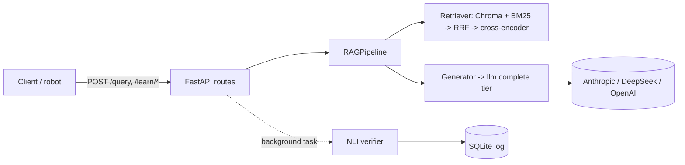

# NutriPepper RAG Backend

<p align="center">
  <br>
  <sub>Photo by <a href="https://unsplash.com/@agk42?utm_source=unsplash&utm_medium=referral&utm_content=creditCopyText">Alex Knight</a> on <a href="https://unsplash.com/photos/white-robot-near-brown-wall-2EJCSULRwC8?utm_source=unsplash&utm_medium=referral&utm_content=creditCopyText">Unsplash</a></sub>
</p>

Grounded nutrition question answering and lesson generation for the **Pepper** nutrition-education robot, built on Kenyan and WHO/FAO guidance documents.

  -orange)

> **Educational tool, not medical advice.** Answers come from a small set of public guideline documents and are produced by a language model. See [Known issues and limitations](https://github.com/PantheraNestah/nutripepper-rag/wiki/Known-Issues-and-Limitations).

## What it is

NutriPepper is a Retrieval-Augmented Generation (RAG) service. A client (the robot's controller, a tablet app, or any HTTP client) sends a nutrition question or a topic. The service finds the most relevant passages in its knowledge base, asks a language model to answer **only from those passages** with inline citations, and returns the answer together with the sources used.

It exposes three endpoints:

- **`POST /query`**: a cited answer to a nutrition question.
- **`POST /learn/structured`**: a short multi-beat lesson with speech, gesture and tablet-display content for the robot.
- **`POST /learn/text`**: a long-form narrative lesson with quiz hints.

The knowledge base is six public documents (Kenya Ministry of Health, FAO, WHO and Codex), split into 810 chunks. After each `/query` answer, a background step checks the answer against the retrieved text and stores a grounding score. That score is logged, not returned to the client.

## Features

- **Hybrid retrieval**: ChromaDB semantic search and BM25 keyword search, fused with Reciprocal Rank Fusion, then re-ranked by a cross-encoder.
- **Tiered, multi-provider LLM layer**: callers ask for a *tier* (complex, medium, easy) and each tier maps to a `provider:model:effort` setting. Supports Anthropic (with prompt caching), DeepSeek and OpenAI. Mix providers per tier.
- **Grounding verification**: a natural-language-inference model scores each answer against its sources after the response is sent, so it never adds latency.
- **Interaction log**: queries, answers, retrieved chunks, grounding results and latency go to SQLite (WAL mode).
- **Evaluation harness**: test-set generation, replay and metric scripts under `evaluation/`.
- **Fast first request**: models are preloaded at startup.

## Architecture at a glance



Retrieval and LLM calls run in worker threads so the event loop stays free. Details: [Architecture](https://github.com/PantheraNestah/nutripepper-rag/wiki/Architecture).

## Quick start

**Prerequisites:** Python 3.12 (the version this was tested on), a few GB of free disk (PyTorch plus three Hugging Face models), internet access on first start, and an API key for at least one LLM provider (Anthropic, DeepSeek or OpenAI).

### 1. Install

```bash
git clone https://github.com/PantheraNestah/nutripepper-rag.git
cd nutripepper-rag
python3.12 -m venv .venv && source .venv/bin/activate
```

`requirements.txt` pins NVIDIA CUDA and Triton packages that only install on a machine with a GPU. **On a machine without a GPU**, install CPU PyTorch first and skip those lines. This is the way it was tested (torch `2.12.0+cpu`):

```bash
pip install torch==2.12.0 --index-url https://download.pytorch.org/whl/cpu
grep -vE '^(nvidia-|cuda-|triton)' requirements.txt | grep -v '^torch==' > /tmp/requirements.nogpu.txt
pip install -r /tmp/requirements.nogpu.txt
```

On a GPU machine, `pip install -r requirements.txt` is the intended path (not tested here).

### 2. Configure

```bash
cp .env.example .env
```

Edit `.env` and set the key for each provider your tiers use (`ANTHROPIC_API_KEY`, `DEEPSEEK_API_KEY` or `OPENAI_API_KEY`). `.env` is gitignored; never commit it. With no other settings, all tiers use Anthropic (Sonnet 5.5 for complex, Haiku 5.5 for medium and easy). To use DeepSeek only:

```
LLM_MODEL_COMPLEX=deepseek:deepseek-flash:high
LLM_MODEL_MEDIUM=deepseek:deepseek-flash:low
LLM_MODEL_EASY=deepseek:deepseek-flash:low
```

All settings: [Configuration](https://github.com/PantheraNestah/nutripepper-rag/wiki/Configuration).

### 3. Build the vector store

The vector store is **not in the repository** (`app/chroma_storage/` is gitignored), but the extracted text is: `data/knowledge_base/nutrition_knowledge_base.json` (810 chunks). Build the store from it. Run this from anywhere; it downloads the embedding model on first use and takes about 20 minutes on a CPU-only machine (measured: 22 minutes):

```bash
python data/scripts/build_vector_store.py
```

It writes to `app/chroma_storage/`, where the app looks for it. It is safe to re-run: unchanged chunks are skipped, so a re-run takes about half a minute. Add `--reset` to start from an empty collection. See [Knowledge Base](https://github.com/PantheraNestah/nutripepper-rag/wiki/Knowledge-Base) for the full pipeline.

### 4. Run

```bash
./run.sh          # uvicorn app.main:app --host 0.0.0.0 --port 8000 --reload
```

`run.sh` listens on all network interfaces and has no authentication. For local use, prefer:

```bash
uvicorn app.main:app --host 127.0.0.1 --port 8000
```

On start the app creates the SQLite database and **preloads the models (about 50 s on a CPU)** before accepting requests. Set `PRELOAD_MODELS=false` for a faster start; the models then load on the first request instead.

### 5. Try it

Interactive docs are at <http://127.0.0.1:8000/docs>. Or:

```bash
curl -s -X POST http://127.0.0.1:8000/query \
  -H 'Content-Type: application/json' \
  -d '{"user_query": "What are good sources of iron for a toddler?"}'
```

## API at a glance

| Endpoint | Body | Returns |
|---|---|---|
| `POST /query` | `{"user_query": "..."}` | Cited answer plus the retrieved chunks |
| `POST /learn/structured` | `{"concept": "..."}` | 4-5 teaching beats (speech, gesture, tablet content) |
| `POST /learn/text` | `{"concept": "...", "description": "..."}` (description optional) | Long-form lesson text, quiz hints, sources |

An optional `X-Session-ID` header is stored with each logged interaction. Example `/query` response (shortened):

```json
{
  "status": "success",
  "message": "Query processed successfully",
  "data": {
    "original_query": "What are good sources of iron for a toddler?",
    "processed_query": "what are good sources of iron for a toddler?",
    "retrieved_context": [{"text": "...", "source": "...", "authority": "...", "domain": "nutrition"}],
    "generated_response": "Iron-rich foods include ... [1]"
  }
}
```

Full reference, including error behaviour: [API Reference](https://github.com/PantheraNestah/nutripepper-rag/wiki/API-Reference).

## Configuration

| Variable | Purpose |
|---|---|
| `ANTHROPIC_API_KEY`, `DEEPSEEK_API_KEY`, `OPENAI_API_KEY` | Keys; only the providers your tiers use are needed |
| `LLM_MODEL_COMPLEX`, `LLM_MODEL_MEDIUM`, `LLM_MODEL_EASY` | Tier to model, as `provider:model[:effort]` |
| `DEEPSEEK_BASE_URL` | Override the DeepSeek endpoint (optional) |
| `ANTHROPIC_PROMPT_CACHE`, `ANTHROPIC_REFUSAL_FALLBACK` | Turn Anthropic features off with `false` |
| `PRELOAD_MODELS` | `false` skips startup preloading |
| `DATABASE_URL` | Default `sqlite+aiosqlite:///./nutripepper.db` |

## Testing

```bash
pip install pytest        # not in requirements.txt
python -m pytest tests -q
```

47 tests, no network access or API keys needed (the LLM clients are faked, and the tests use a temporary database). They cover the LLM layer, the concurrency fixes and the startup preload. They do **not** cover retrieval quality, the verifier models or the endpoints end to end. See [Testing](https://github.com/PantheraNestah/nutripepper-rag/wiki/Testing).

## Evaluation

`evaluation/` contains a test-set generator, a replay script and a metrics script. The committed results are a **historical baseline**:

> Evaluation numbers in this repository were produced before the move to Anthropic and DeepSeek. The generator model was not recorded in the result files; the project documents attribute earlier runs to GPT-3.5-turbo and GPT-4-turbo. Retrieval metrics depend only on the retriever, the knowledge base and the test set. Grounding, attribution and latency figures depend on the generator and the host, are not comparable to the current default setup, and have not been re-run.

Details and caveats: [Evaluation](https://github.com/PantheraNestah/nutripepper-rag/wiki/Evaluation).

## Project layout

```
app/
  main.py            FastAPI app, startup (DB + model preload)
  api/routes.py      /query, /learn/structured, /learn/text
  services/          pipeline, retriever, generator, llm, warmup, interaction_logger
  core/              verifier (NLI), citation instrumentation, config
  database/          SQLAlchemy models and async engine
  schemas/           request and response models
alembic/             migration scripts (see known issues)
data/                source PDFs, extracted chunks, ingestion scripts
evaluation/          test set, replay and metrics scripts, results
tests/               unit and concurrency tests
```

More: [Project Layout](https://github.com/PantheraNestah/nutripepper-rag/wiki/Project-Layout).

## Status, limitations and security

This is an **alpha** (`v0.1.0-alpha`) research prototype, not a production service.

- No authentication or rate limiting, and CORS allows every origin. Do not expose it to the internet as is.
- Safety relies on prompt instructions only; there is no separate safety classifier.
- English only. Tables in the food-composition document are chunked poorly.
- Every query, answer and session ID is stored in plaintext in the local SQLite database. There is no retention policy.
- If the language model call fails, the API returns a fallback message with HTTP 200 rather than an error.
- `alembic upgrade head` does not work on a new database; see the wiki for the workaround.

Full list: [Known Issues and Limitations](https://github.com/PantheraNestah/nutripepper-rag/wiki/Known-Issues-and-Limitations).

## Documentation

The wiki is the main reference: [Home](https://github.com/PantheraNestah/nutripepper-rag/wiki) · [Getting Started](https://github.com/PantheraNestah/nutripepper-rag/wiki/Getting-Started) · [Architecture](https://github.com/PantheraNestah/nutripepper-rag/wiki/Architecture) · [Operations and Troubleshooting](https://github.com/PantheraNestah/nutripepper-rag/wiki/Operations-and-Troubleshooting) · [Contributing](https://github.com/PantheraNestah/nutripepper-rag/wiki/Contributing)

## Data sources

The knowledge base is built from these public documents: Kenya Food Composition Tables (2018, FAO / Kenya MoH); Kenya Nutrient Profile Model (2025, Kenya MoH); Kenya Nutrition Action Plan 2018-2022 (Kenya MoH); National Guidelines for Healthy Diets and Physical Activity (2017, Kenya MoH); WHO healthy diet fact sheet (2024); General Principles of Food Hygiene (2023, FAO/WHO Codex). Check each publisher's terms before redistributing the documents or extracted text.

## License

No license has been specified yet.
